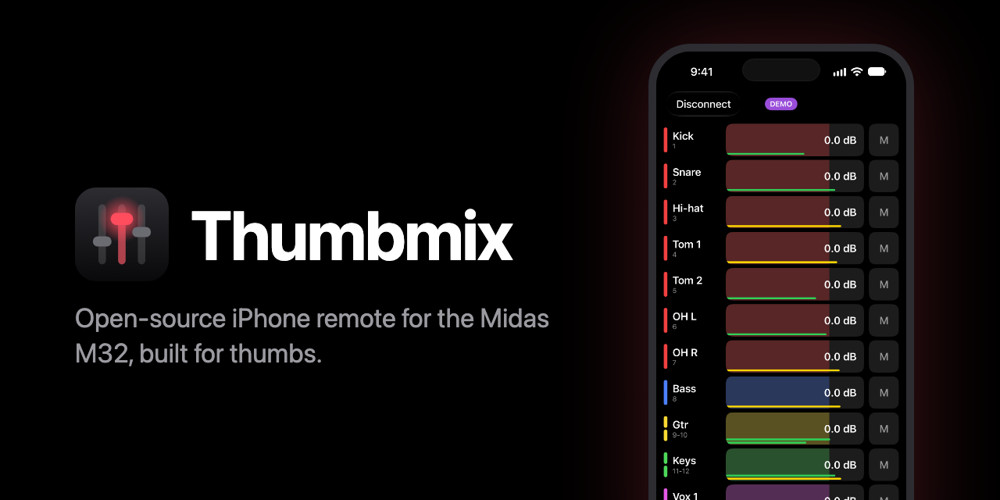

# Thumbmix



An open-source (MIT) iPhone remote for the Midas M32, built for thumbs. Its controls are horizontal fader rows that you drag anywhere. Every common action is at most two taps deep. Channels use the desk's own names and colours everywhere, and the screen is OLED black.

It covers inputs, aux ins, FX returns, buses, matrices, Main LR, Main M and DCAs. Where the desk has them, it controls:

- faders, mutes, solo and pan, and each strip's switch to Main LR
- preamp gain, trim, 48V, polarity and delay
- low cut, 4- or 6-band EQ over the desk's spectrum, gate and compressor (with their key, the comp's position and Auto time)
- inserts: on/off and position (the slot is shown, not changed yet)
- sends, each with its tap point and send pan, and "Fed by" (sends on fader) on buses, matrices and the mains
- stereo links: a linked pair is one row, and the Mix tab links and unlinks it
- names, colours and icons
- meters

Hold a row to type a value; double-tap it to reset. It runs alongside Mixing Station and the desk, and changes made on either show up live.

It supports the Midas M32 family on its latest firmware only, on iPhone only (iOS 26 or newer: iPhone 11, SE 2nd generation and later), in portrait only.

## Install with SideStore (free Apple ID)

1. In SideStore, open Sources, tap +, and add `https://raw.githubusercontent.com/Auxority/thumbmix/sidestore/source.json`. Install Thumbmix from it; SideStore then offers each new version by itself.

   Or by hand: download `Thumbmix.ipa` from the newest of the [releases](../../releases). Until 1.0.0 they are all pre-releases, which GitHub's "latest" link skips. Every merge to `main` with a `feat:`, `fix:` or `perf:` commit publishes one once CI passes, tagged with its [semantic version](https://semver.org): a feature bumps the minor number, a fix or performance change the patch number. To build it yourself instead, run `scripts/build-ipa.sh` on a Mac with Xcode (iOS 26 SDK or newer; CI uses Xcode 27) and XcodeGen (`brew install xcodegen`). It writes `build/ipa/Thumbmix.ipa`.

   AirDrop the IPA to the iPhone, then open it with SideStore (My Apps → +).
2. On first launch, iOS asks for Local Network access. Allow it, or Thumbmix can't reach the desk.

SideStore re-signs apps every 7 days. A free Apple ID allows 3 active sideloaded apps, and SideStore itself counts as one.

## Connect

Join the console's Wi-Fi and open Thumbmix. It scans the network and lists every M32 it finds; tap one to connect. Not listed, say on another VLAN? Tap **Enter IP** and type the address the desk shows under Setup → Network. Thumbmix remembers each console it connected to: the last one is the card with the big **Connect**, marked Online when it answered the scan. Swipe a console in the list to forget it. After a dropout Thumbmix keeps retrying by itself ("Disconnected — retrying").

No console nearby? **Try a demo console** runs a demo M32 inside the app, so every screen works without a mixer. A DEMO pill at the top of the screen shows it isn't a real desk, and each visit starts from a fresh demo desk.

## Presets

Save a strip's settings (input, EQ, gate, comp, and if you like fader and sends) and load them onto any strip that can take them. Tap the strip's name, then **Presets**. A strip whose name contains a preset's match words lists it first. Loading asks before it raises the gain, switches 48V or flips polarity; saying Keep skips only that one setting.

Your presets live on the iPhone in the Files app (On My iPhone › Thumbmix › Presets), so you can copy, edit or share the `.json` files; **Share** on a preset sends it by AirDrop or Messages, and a file or folder added under **Sources** takes one in. A preset file holds each part's values by the desk's own address under the strip (`"gate": {"gate/thr": -40, "gate/mode": "GATE"}`), in real units; anything the desk couldn't take is refused and named, never clamped.

**Sources** on the Presets page adds presets from a folder or a single file picked in Files (iCloud Drive, On My iPhone, a USB stick), or from the web: an `https://` address of an `index.json` that lists preset files by relative path (`{"format": "thumbmix-source", "version": 1, "name": "…", "presets": [{"path": "kick.json"}]}`). A folder source reads every `.json` in it, up to 200. A source's presets are read-only and kept for use offline; **Save a copy** puts one on the iPhone to change it.

This repo's [`presets/`](presets) folder is the default source, there on first launch. To add it back after removing it, choose **Add a source → Web address…** and paste:

```
https://raw.githubusercontent.com/Auxority/thumbmix/main/presets/index.json
```

## Report a problem

Saw something go wrong? Shake the phone while Thumbmix is open, tap **Share**, and attach the file to a [new issue](../../issues/new) with what you did and what you expected. The file holds what Thumbmix logged since it opened: desk and channel names and network addresses, nothing about you. Share it before closing the app; a fresh start begins a new log.

## Develop

Install the tools with `brew install xcodegen swiftlint`; `swift format` ships with Xcode.

```bash
scripts/lint.sh                             # style (swift-format) and complexity/size limits (SwiftLint)
scripts/unused.sh                           # unused code (swiftlint analyze, ~1.5 min: two clean builds)
swift test --package-path Core              # protocol, state and UI maths
scripts/ui-test.sh                          # the UI suite, each test against its own fake desk
scripts/strings.sh                          # refresh both String Catalogs (App and Core) after changing text
scripts/render-icon.sh                      # render Design/AppIcon.svg into the app icon (brew install librsvg imagemagick)
scripts/render-strip-icons.sh               # render Design/strip-icons into the picker's icons (--sheet out.html to review)
scripts/store-screenshots.sh                # retake SideStore's screenshots (Design/store-screenshots) on the iPhone 17
swift run --package-path Core fake-m32      # a fake M32 on 127.0.0.1:10023 (or the port you pass) for the simulator
xcodegen generate && open Thumbmix.xcodeproj
```

The fake M32 keeps every set it receives, so restart it for a clean desk. CI also runs `scripts/test-next-version.sh` and `scripts/test-sidestore-source.sh`: run them after changing the release scripts. The SideStore check also wants each store screenshot in place, at the iPhone 17's 1206 × 2622.

`scripts/ui-test.sh` runs the UI tests on an iPhone SE (3rd generation) simulator on iOS 26 or newer, which is 375 pt wide like the iPhone 11 Pro. It runs three test classes at a time on clones of that simulator, and each test starts its own fake desk inside the test runner, so a `fake-m32` you have running doesn't matter. `UI_TEST_WORKERS` sets how many clones (default 3). Name tests or classes to run only those, one at a time on the simulator itself: `scripts/ui-test.sh ChannelUITests EQBandUITests/testBusResetsAllSixBands`. `--serial` runs the whole suite that way, for when cloning fails. Other arguments starting with `-` go to `xcodebuild`; `UI_TEST_DESTINATION` (an `xcodebuild -destination` value) picks another simulator. A run whose first test hasn't started 2 minutes after the build has hung, and the script stops it (exit 2). The full log lands in `build/ui-test.log`, the result bundle in `build/ui-test.xcresult` (the script prints its passed, failed and skipped counts), and screenshots taken by the tests in `build/screens`.

## Check a real console

`swift run --package-path Core m32-probe <M32 IP>` is read-only: it never changes the desk. Where a check needs a setting changed, it asks you to change it on the desk and reports what it sees. By section, it prints:

1. the console's model and firmware
2. whether `/xremote` pushes arrive while other remotes are connected
3. what feeds each input (Rec or Playback routing, the preamp), with its gain and trim; 3b: the same for the aux ins
4. the names and the DCA bit order
5. the meter layout, including the DCA slots
6. the RTA source, and whether its meter streams
7. how stereo links behave: the Link Preferences, which side moves when a linked fader moves, what linking copies, whether an unticked preference really keeps the sides apart, whether the Gain/Delay link carries polarity (7e), and whether a matrix has an invert (7f) and an FX return a bus 1 tap point (7g)
8. whether the desk's own dB text for each input fader matches what the app shows
9. whether a linked bus pair's send moves both buses, and whether a linked channel pair keeps a send pan per side
10. what each send tap point really hears, by bus meters while you change the desk: a comp before the EQ in a Pre-EQ send, one tap for both buses of a pair, mute and pre-fader sends, Subgroup's fixed level, and Follow LR pan
11. the EQ defaults after Reset on the desk, for a channel, an aux in and an FX return
12. connect speed: the overview read with 8 and with 32 requests in flight, and how many went unanswered
13. the bus send meters: whose sends they show, and whether they report past 0 dBFS

## Acceptance checklist (real M32)

1. Scan finds the M32 and marks it Online, also when the desk is switched on after the Connect screen opened (within ~5 s of it booting), and Enter IP works: it starts from the phone's network, shows the number keypad (on a Dutch phone its comma key works too), and "192.168.1" is refused. With Local Network switched off, Connect says "Can't reach …", and its Settings button opens Thumbmix's page with the Local Network switch.
2. Names and colours match the desk for all strip kinds, and a name, colour or icon edited in the app shows up on the desk.
3. A fader moved on the desk moves in the app, and vice versa, with Mixing Station also connected.
4. Meters move and roughly match the desk. The EQ tab's spectrum follows the signal, and the desk's RTA source is back as it was after leaving the tab.
5. Gain on an input changes the matching DL32 preamp. Phantom power toggles after its alert, and trim, polarity and delay work. Reset input sets them back on the desk and leaves 48V on.
6. Low cut, gate, EQ and compressor edits are audible or visible on the desk, including the key, the comp's position and Auto time. Reset gate, Reset comp and Reset bands on a linked pair reset both sides on the desk.
7. Solo lights the desk's solo, and the LR pill takes a strip out of Main LR and back. On the overview, hold a name and drag down several names: the desk solos each one, a tick per row; hold near the bottom edge and the list scrolls on. Clear above the tabs clears the desk's solos, and one set on the desk shows up in the app. With Exclusive solo ticked on the desk, a run asks before soloing a second strip.
8. An insert's slot matches the desk, and its on/off and position change the desk.
9. Sends and Fed by match the desk's sends-on-fader, also on Main LR and Main M. A send's tap point, send pan and Follow LR pan match the desk.
10. A pair linked on the desk shows as one row; linking and unlinking from a strip's Mix tab does the same on the desk. Move a pair's fader with Console.app on the Mac filtered on "thumbmix": no "didn't follow a linked edit" line.
11. Switch a mute group on the Main page: the desk's mute group key lights and the M of each strip in it gets a red border. Switch one on the desk: the app follows (at the latest when the Main page opens). Hold a group and tick a strip: the desk's mute group screen shows it in that group. Tick a DCA and a mute group in a strip's edit sheet: the desk shows both after Done, neither after Cancel.
12. Power off the access point: the app shows "Disconnected — retrying" and disables its controls. Restore power: the app resyncs and re-enables them.
13. VoiceOver's swipe up and down adjusts parameter rows (XCUITest can't drive it).

## Credits

The protocol knowledge comes from Patrick-Gilles Maillot's *Unofficial X32/M32 OSC Remote Protocol*; what the desk shows and calls things comes from the Midas M32 user manual. Thumbmix is not affiliated with Midas, Behringer or Music Tribe.

## Licence

MIT. See `LICENSE`.
